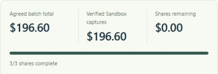

# CommonGround

**Keep your brand. Share buying power.**

Three small brands need 100 boxes. LUMA wants 40 black cartons. JUNIPER and FORMA want 35 and 25 kraft cartons. Their supplier’s minimum is 100 **per carton type**, so neither order qualifies. CommonGround helps the brands decide whether a shared kraft carton, individual branding and a revised allocation would meet every buyer’s terms.

[Open the live demo](https://commonground-sejun-2026.pplower.chatgpt.site) · [Watch the 1:51 demo on YouTube](https://youtu.be/S2poxOXK078) · [Judge walkthrough](docs/JUDGE_WALKTHROUGH.md)


## Try the $80 case

Open the English demo, choose **Compare shared plans**, and select **$80 · quantities fixed**. The sample runs without signing in. LUMA’s original 40 cartons would cost $82. The app asks whether LUMA can raise its budget or whether LUMA and FORMA can reconsider quantities.

1. Under **Keep every budget limit**, choose **Review this question**. Allow LUMA to consider 38–40 cartons and FORMA to consider 25–27. Both roles must agree before these ranges can be saved.
2. Review the resulting plan. LUMA would take 38 kraft cartons with a black branded sleeve, JUNIPER would keep 35 kraft cartons with its own label, and FORMA would take 27. The affected roles approve the exact changes. All three then approve their own final prices.
3. Use **Sample checkout** to explore the separate balances and production brief. On the live site, **Sign in with ChatGPT** opens the model-backed request form and the PayPal Sandbox path. Sandbox approval requires a Sandbox Personal buyer. Each signed-in operator has their own workspace and payment records.

| Brand | Cartons | Approved share, including delivery |
| --- | ---: | ---: |
| LUMA | 38 | $78.30 |
| JUNIPER | 35 | $65.75 |
| FORMA | 27 | $52.55 |
| **Shared run** | **100** | **$196.60** |

One operator plays three fictional brands. The example uses synthetic supplier rules and prices. The brief is for supplier review. It does not place a manufacturing order.

## What the integrations do

**OpenAI** extracts quantity, permitted bounds, budget and timing from a request. The buyer sees the original words supporting each value, reviews the form and saves the conditions. When a plan is blocked, the model can select a question and evidence from options that the server has already calculated. The TypeScript planner checks minimum quantities, integer-cent prices and separate consent requirements. In verified English and Korean runs, `gpt-5.4-mini` preserved the difference between exactly 40 units and a permitted range of 38–40.

**PayPal Sandbox** creates a distinct order for each approved share. After the buyer approves in PayPal, **Check payment** verifies the capture, currency, amount and binding to the approved quote before the app records it. In the hosted run, capturing LUMA’s $78.30 left $118.30 outstanding. JUNIPER and FORMA completed the two remaining captures under the same quote. The app showed **3/3 complete**, $196.60 verified and $0.00 remaining.



**Cloudflare D1** stores proposals, approved quotes and payment attempts by owner. The printable brief brings together all three quantities, individual approvals and Sandbox records. A buyer’s approved payment is retained if another buyer leaves checkout incomplete.

## Local setup

Run these commands in the directory containing `package.json`. Use Node.js 22.13 or later and pnpm 11.25.0. A fresh Windows installation using Node.js 25.8.1 passed the frozen dependency install, type check and build. Package registry access is required for the initial installation.

### 1. Install and build

```sh
pnpm install --frozen-lockfile
pnpm run build
```

The build generates `dist/server/wrangler.json` with a local `DB` binding.

### 2. Initialize a fresh local database

On a new checkout, apply both migrations once, in order. These commands target the local database.

```sh
node --import ./scripts/sites-env.mjs ./node_modules/wrangler/bin/wrangler.js d1 execute DB --local --config dist/server/wrangler.json --persist-to .wrangler/state --file drizzle/0000_misty_lockjaw.sql
node --import ./scripts/sites-env.mjs ./node_modules/wrangler/bin/wrangler.js d1 execute DB --local --config dist/server/wrangler.json --persist-to .wrangler/state --file drizzle/0001_ai_daily_usage.sql
```

On a previously used checkout, inspect the existing tables first.

```sh
node --import ./scripts/sites-env.mjs ./node_modules/wrangler/bin/wrangler.js d1 execute DB --local --config dist/server/wrangler.json --persist-to .wrangler/state --command "SELECT name FROM sqlite_master WHERE type='table' AND name LIKE 'cg_%' ORDER BY name;"
```

The initial migration creates `cg_approved_quotes`, `cg_payment_attempts`, `cg_proposals` and `cg_workspaces`. If those four tables already exist and `cg_ai_daily_usage` is absent, execute only the second migration. Skip both when all five tables exist.

### 3. Start the app

```sh
pnpm run dev
```

Open the printed loopback URL. The portable profile defaults to `http://127.0.0.1:5173`. For a local test identity, visit `/signin-with-chatgpt?return_to=/` on that same origin. This development sign-in is limited to the local development profile. The explicit Windows launch used in verification was `node scripts/run-framework.mjs dev --host 127.0.0.1`.

### 4. Configure optional local providers

The local simulation works without provider credentials. For local provider testing, copy the empty `.env.example` to an untracked `.dev.vars`, fill in the required server-side values and restart the development server.

| Variable | Use |
| --- | --- |
| `OPENAI_API_KEY` | Enables actual request interpretation and model-backed guidance. |
| `OPENAI_MODEL` | Defaults to `gpt-5.4-mini`. |
| `PAYPAL_CLIENT_ID` and `PAYPAL_CLIENT_SECRET` | Credentials from the same PayPal Sandbox Business application. Use a separate Sandbox Personal account for buyer approval. |
| `ALLOW_LOCAL_DEMO_AUTH` | Optional development-only loopback shortcut. Defaults to false. |

With `.dev.vars` present, the Cloudflare local runtime does not also load `.env` as Worker bindings. Hosted test access uses the site's configured server credentials. [Cloudflare local environment variables](https://developers.cloudflare.com/workers/local-development/environment-variables/) · [PayPal Sandbox accounts](https://developer.paypal.com/sandbox-testing/accounts)

### 5. Run the checks

```sh
pnpm run test
pnpm run typecheck
pnpm run build
```

Provider tests in the suite inject responses. The three hosted Sandbox captures and the browser-to-OpenAI verification were separate integration runs.

The public app allows 20 outbound AI requests per signed-in user and 300 across the site per UTC day. Interpretation and guidance share this limit and retries consume requests. When the limit is reached, manual editing, rule-based plan comparisons, approvals and checkout remain available.

## Project map

| Location | Responsibility |
| --- | --- |
| `components/workspace-v2.tsx`, `components/use-order-workspace.ts` | Brand requests, condition review, approvals, checkout and brief |
| `lib/engine.ts`, `lib/planning.ts`, `lib/negotiation.ts` | Synthetic supplier rules, feasible allocations, questions and permissions |
| `lib/intent.ts`, `lib/ai-proposal.ts` | Grounded request extraction and model selection among computed options |
| `lib/paypal.ts`, `lib/paypal-service.ts` | Sandbox order creation, capture and verification |
| `app/api/`, `db/`, `drizzle/` | Worker routes, persistent quote state and D1 migrations |
| `tests/` | Domain, planning, AI, access and payment regression coverage |

For the product-specific minimums that inspired the example, see the [supplier grounding note](docs/SUPPLIER_GROUNDING.md). The [research notes](docs/RESEARCH_NOTES.md) describe the systems and studies that informed the design.

## License

CommonGround is released under the [MIT License](LICENSE). The repository retains the upstream notices for the [Sites Vite plugin](scripts/vite/sites-vite-plugin.LICENSE) and [vendored shadcn styles](vendor/shadcn-tailwind-4.13.0.LICENSE.md).
